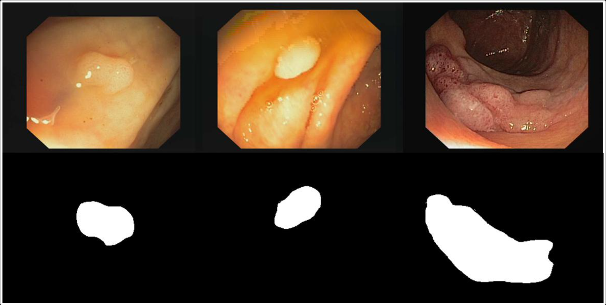

# Esophagus Segmentation Tasks



## Train Process
The main training file is:
```
train.py
```
Moreover, if you want to use multi-card parallel training, you can adjust the relevant parameters and execute:
```
train.sh
```
It is worth noting that all parameter indicators related to training and saving are saved in the following files:
```
config.yml
```
Please note that the ```finetune.model_choose``` parameter in this file is used to select the test model and is unique. ```finetune.checkpoint``` is used to give the saved file name. Please remember to change it in time to avoid parameter file overwriting.

## Verify Process
The main verifing file is:
```
verify.py
```
Moreover, if you want to use multi-card parallel training, you can adjust the relevant parameters and execute:
```
verify.sh
```

## Datasets
### There are the Esophagus Segmentation Tasks:

### CVC-ClinicDB
1、The dataloader file is 
```
src \ CVCLoder.py
```
2、Please rename the Ground Truth folder in the CVC-ClinicDB decompressed data to GroundTruth, that is, remove the spaces. and fill the root path in the following files:
```
config.yml
```

### Other Task
Please add it according to the above format.\
Especially when adding additional dataloader files, do not modify src\CVCLoder.py

## verification
Users can use the following files to visualize segmentation tasks: 
```
visualization.py
```
It is worth noting that if visualization is required, the user needs to place the image to be segmented under this path:
```
visualization/img
```
After the visualization program is executed, the visualization results will be observed under this path:
```
visualization/output
```


