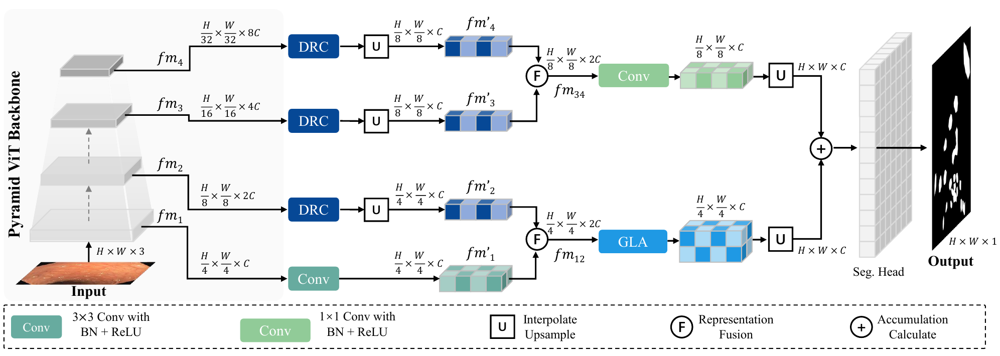
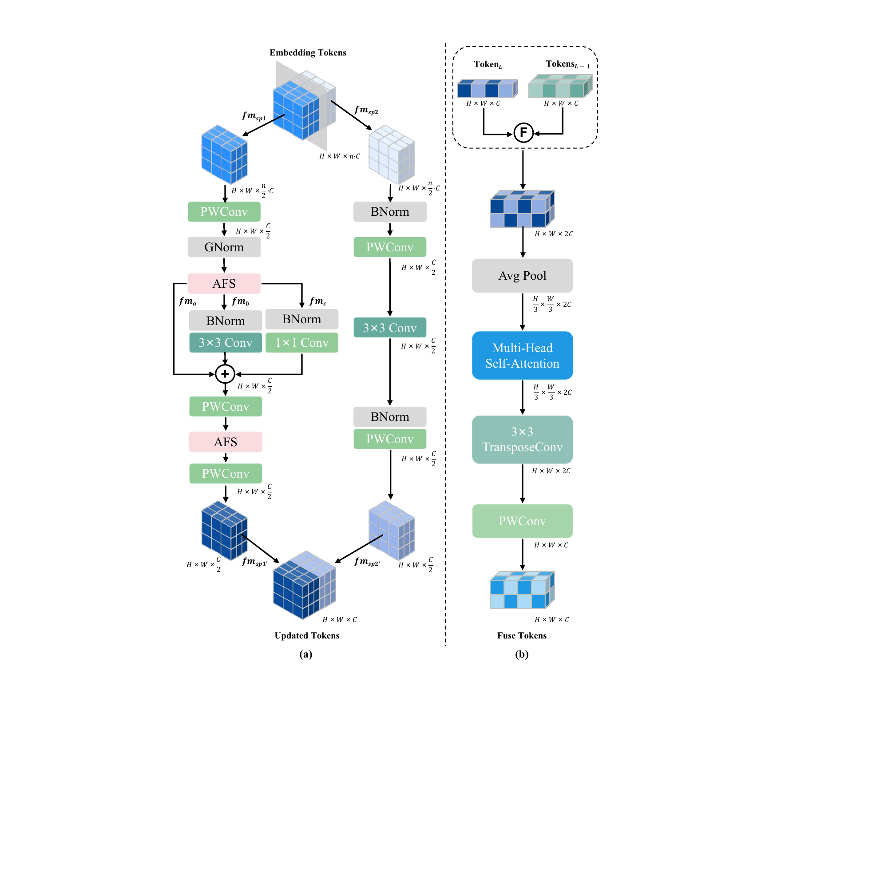
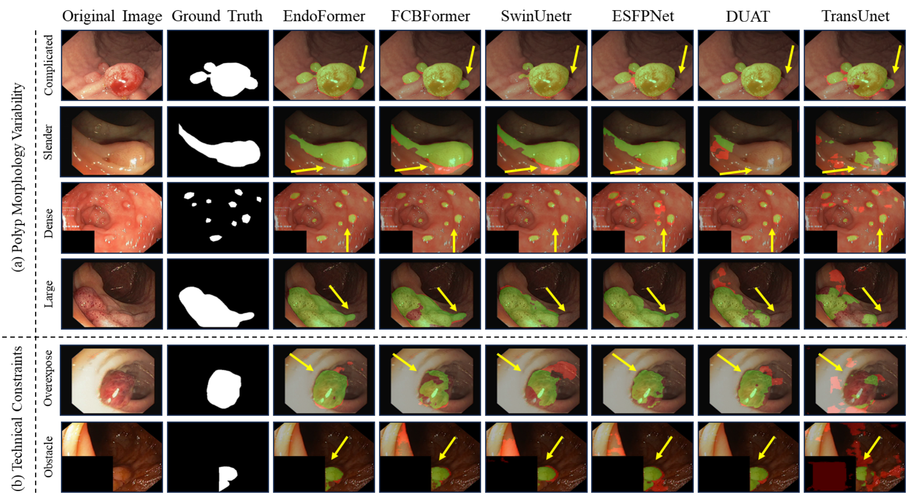
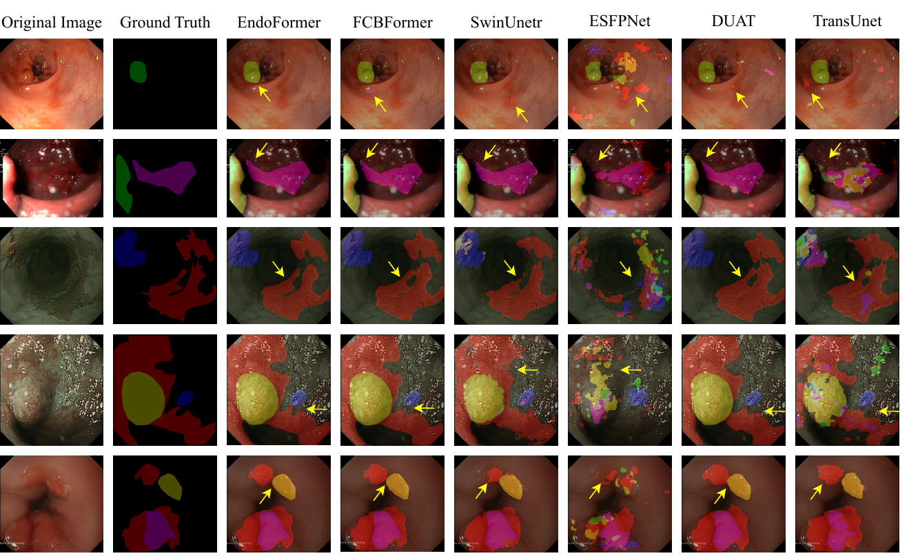

# EndoFormer: A Hybrid Transformer-Based Approach for Enhanced Polyp Segmentation in Endoscopic Imaging

> 🎉 This work is published in **IEEE Journal of Biomedical and Health Informatics (JBHI)**.

Official implementation of **EndoFormer**, a hybrid Transformer framework for fully automatic
polyp segmentation in endoscopic images.

## 🧩 Requirements

- Python 3.10 or newer
- A CUDA-capable GPU and a CUDA-enabled PyTorch build
- On Windows, run `train.sh` / `verify.sh` through WSL, or translate them to `torchrun` in your shell

---

## 🚀 Quick Start

### 1) Install dependencies

The environment is declared in `pyproject.toml` and managed with [uv](https://docs.astral.sh/uv/):

```bash
pip install uv          # or see https://docs.astral.sh/uv/getting-started/installation/
uv sync                 # creates .venv and installs everything
```

`uv sync` resolves against the committed `uv.lock`, so every run reproduces the same
dependency set. To include the plotting packages used by `visualization.py`:

```bash
uv sync --extra visualize
```

Run commands inside the environment with `uv run`:

```bash
uv run python train.py
uv run python verify.py
```

A plain `pip` install also works if you add the plotting dependencies yourself:

```bash
pip install -e .
pip install matplotlib imageio Pillow   # only for visualization.py
```

### 2) Pretrained backbone weights

The encoder is initialized from ImageNet weights. `config.yml` expects them here:

```text
pretrained/pvt_v2_b2.pth
```

Download the official checkpoint (101 MB):

```bash
mkdir -p pretrained
wget -P pretrained https://github.com/whai362/PVT/releases/download/v2/pvt_v2_b2.pth
```

To use a different location, change `pretrained` under `model` in `config.yml`.
Leaving that path empty trains the encoder from scratch.

### 3) Configure dataset paths

Set `run.dataset` and the matching `data.root` in `config.yml`. By default every
dataset is expected under `./datasets/`.

Supported datasets and their folder conventions:

- **CVC-ClinicDB** (`run.dataset: CVC_ClinicDB`)
  - `data.root` should contain `Original/` (images) and `GroundTruth/` (masks)
  - Rename `Ground Truth` → `GroundTruth` (drop the space) after extracting

- **Kvasir-SEG** (`run.dataset: Kvasir_SEG`)
  - `data.root` should contain `images/` and `masks/`

- **EDD2020 (Seg)** (`run.dataset: EDD_seg`)
  - `data.root` should contain `originalImages/` and `masks/`
  - Multi-class masks: for `originalImages/XXX.<ext>`, masks are looked up as
    `masks/XXX_<class>.tif` with `<class>` in `BE`, `cancer`, `HGD`, `polyp`, `suspicious`

- **PolypGen** (`run.dataset: PolypGen`)
  - `data.root` contains one subfolder per centre, each with `images/` and `masks/`
  - For `images/NAME.<ext>`, the loader expects `masks/NAME_mask.jpg`

- **SUN-SEG** (`run.dataset: Sun_seg`)
  - `data.root` should contain
    `TrainDataset/{Frame,GT}/<clip>/*` and `TestHardDataset/Unseen/{Frame,GT}/<clip>/*`

The dataset also determines the label space: binary datasets predict one mask,
EDD 2020 predicts its five lesion classes. The output channels of the model
follow from `src/data/registry.py`, so nothing needs to be set twice.

### 4) Train / Evaluate

Single GPU:

```bash
uv run python train.py
uv run python verify.py
```

Multi-GPU via `torchrun`:

```bash
uv run torchrun --nproc_per_node 2 --master_port 29400 train.py
uv run torchrun --nproc_per_node 4 --master_port 29400 verify.py
```

Or use the provided scripts:

```bash
bash train.sh
bash verify.sh
```

Useful `train.py` flags: `--dataset`, `--epochs`, `--lr`, `--optimizer {adamw,adam,sgd}`,
`--seed`, `--data-root`, `--pretrained` (initialize from a saved model),
`--backbone-pretrained`, `--checkpoint-name`, `--no-resume`, `--gpu`, `--config`.
Every flag maps to a key in `config.yml`, so a run can be described either way.

Training keeps the best model under `model_store/<checkpoint>/best/`, where `<checkpoint>` is
`run.checkpoint` in `config.yml`. `verify.py` evaluates that model by default; pass
`--checkpoint <path>` to evaluate another one.

### 5) Visualize

```bash
uv run python visualization.py
```

Place images to segment under `visualization.img_path` and their ground-truth masks under
`visualization.mask_path/GT/`. The script uses the best model saved by `train.py`. Predicted
masks are written to `visualization.mask_path/<dataset>/` and overlays to
`visualization.output_path/<dataset>/`. All three locations are configurable.

---

## 📁 Project Layout

```
train.py             training entry point
verify.py            evaluation entry point
visualization.py     mask and error-map rendering
config.yml           experiment configuration

src/
├── data/
│   ├── registry.py    dataset declarations: layout, classes, augmentation style
│   ├── samples.py     per-dataset file enumeration
│   ├── datasets.py    tensor-producing Dataset classes
│   └── transforms.py  augmentation pipelines
├── model/
│   ├── __init__.py    build_model()
│   └── endoformer.py  the network
├── engine.py          train_epoch / evaluate
├── metrics.py         Dice, mIoU, F1, precision, recall, HD95
├── config.py          config loading and CLI overrides
├── optimizer.py       warmup + cosine learning-rate schedule
└── utils.py           seeding, checkpoint I/O, logging
```

Adding a dataset means writing one enumerator in `samples.py` and adding one
`DatasetSpec` in `registry.py`. The output channels, metric convention and
augmentation style follow from that declaration, so no entry point needs editing.

---

## 🔍 Main Contributions

- **EndoFormer**: a unified hierarchical framework that coordinates intra-level representation
  refinement, progressive spatial reconstruction, and cross-level contextual interaction for
  fully automatic polyp segmentation.
- **Dual Reparameterization Convolutions (DRC)**: strengthens local structural and
  boundary-sensitive representations at each feature level by splitting channels into a texture
  branch (multi-kernel reparameterised convolution) and a spatial branch (pointwise–depthwise–
  pointwise cascade).
- **Global Local Attention (GLA)**: fuses shallow spatial detail with deep semantic context
  through sparse-token multi-head attention and depthwise transposed-convolution reconstruction.
- **Activation Function Selector (AFS)**: a fixed, level-aware assignment of GELU to the shallow
  level and Swish to the deeper levels.
- **State-of-the-art results** on five endoscopic benchmarks, with the lowest HD95 on
  CVC-ClinicDB (4.54 mm) at 25.2 M parameters and 9.9 GFLOPs.

---

## 🧠 Network Architecture

### Overview

EndoFormer uses a PVTv2-B2 encoder that produces four multi-scale feature maps.
The deeper three are refined by DRC; the shallowest carries texture, so it is fused with
the refined second level by GLA and upsampled back to input size. The two deepest levels
are merged by a pointwise convolution instead. Both paths are summed to produce the
segmentation.



### DRC and GLA



- **DRC** (a) splits a feature map along the channel axis into two halves. One half passes
  through a `k x k` depthwise convolution, a `1 x 1` depthwise convolution and the identity,
  summed and mixed by a pointwise MLP; the other half is refined by a lightweight
  pointwise–depthwise cascade. The two halves are concatenated and projected back.
- **GLA** (b) concatenates the shallow feature map with the upsampled deeper one, samples
  sparse tokens by strided average pooling, and lets multi-head self-attention exchange
  context among them. A transposed convolution then restores the resolution.

---

## 📊 Performance

| Dataset | HD95 ↓ | Dice ↑ | mIoU ↑ | Precision ↑ | Recall ↑ |
|---|---|---|---|---|---|
| CVC-ClinicDB | **4.54** | **97.20** | **94.99** | **96.93** | **97.56** |
| Kvasir-SEG | **9.14** | **97.35** | **95.47** | 95.23 | **95.91** |
| SUN-SEG-Hard (Unseen) | **15.56** | **90.18** | **85.92** | 94.94 | **76.54** |
| PolypGen | **8.95** | **95.25** | **92.77** | 95.01 | **96.25** |
| EDD2020 (avg over 5 classes) | **53.72** | **86.47** | **81.41** | **89.26** | **78.48** |

Full comparisons against the published baselines are given in the paper.

---

### 📂 Data Description

All datasets are split **80% train / 20% validation** and evaluated on that validation
partition; SUN-SEG uses its official `TrainDataset` for training and the `TestHardDataset/Unseen`
subset for evaluation. Images and masks are resized to 352×352.

### Dataset: CVC-ClinicDB

- **Size**: 612 colonoscopy images (384×288), 489 / 123 split
- **Challenge**: Polyp segmentation with variable morphology and specular highlights

### Dataset: Kvasir-SEG

- **Size**: 1,000 annotated endoscopic images, 800 / 200 split
- **Challenge**: Gastrointestinal polyp segmentation across varying resolutions

### Dataset: EDD 2020

- **Size**: 386 GI tract frames with 5 lesion types (160 NDBE, 88 Susp., 74 HGD, 53 Cancer, 127 Polyp masks), 308 / 78 split
- **Challenge**: Multi-target segmentation across lesion classes

### Dataset: PolypGen

- **Size**: 3,762 polyp-positive frames from multiple centres, 80/20 split after aggregation
- **Challenge**: Cross-centre generalisation

### Dataset: SUN-SEG

- **Size**: 158,690 colonoscopy frames (49,136 polyp-positive + 109,554 negative)
- **Test set**: SUN-SEG-Hard (Unseen) subset
- **Challenge**: Large-scale, artifact-rich frames

---

## 💻 Hardware Performance

Measured at 352×352 on an NVIDIA V100 GPU:

| Method | Params (M) ↓ | FLOPs (G) ↓ | FPS ↑ |
|---|---|---|---|
| TransUNet | 66.8 | 61.7 | 47.99 |
| UNet | 14.0 | 21.3 | **66.14** |
| Swin UNETR | **6.2** | **9.2** | 53.12 |
| ESFPNet | 21.3 | 13.0 | 43.84 |
| DuAT | 25.1 | 9.9 | 55.56 |
| FCBFormer | 52.9 | 73.3 | 21.88 |
| PVT-CASCADE | 25.2 | 110.7 | 15.25 |
| CFANet | 35.3 | 30.8 | 33.17 |
| MEGANet | 44.2 | 28.8 | 34.75 |
| **EndoFormer (ours)** | 25.2 | 9.9 | 62.29 |

EndoFormer runs at 62.29 FPS with 9.9 GFLOPs, second only to U-Net in throughput.

---

## 🎨 Visualization

### Error maps on CVC-ClinicDB and Kvasir-SEG

Accurate regions are shown in green, errors and missed detections in red. Rows (a) cover
polyp morphology variability — complicated, slender, dense and large lesions — and rows
(b) cover endoscopy-specific constraints such as overexposure and occlusion.



### Qualitative results on EDD 2020

Multi-target segmentation across lesion classes: Barrett's esophagus (BE), adenocarcinoma,
high-grade dysplasia (HGD), polyp and suspicious areas.



---

## 📝 Citation

If you find this repository useful, please cite:

```bibtex
@ARTICLE{long2026endoformer,
  author={Long, Yucheng and Wang, Qiong and Zhang, Mingdu and Huang, Teng and Hu, Ying and Chen, Hao and Zhang, Wensheng and Pang, Yan},
  journal={IEEE Journal of Biomedical and Health Informatics},
  title={EndoFormer: A Hybrid Transformer-Based Approach for Enhanced Polyp Segmentation in Endoscopic Imaging},
  year={2026}
}
```

## 📄 License

Released under the MIT License; see [LICENSE](LICENSE).
